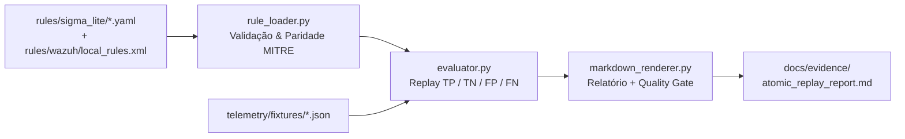

# vtx-detection-lab — Project Cookbook

[](https://github.com/ayslans/vtx-detection-lab/actions/workflows/ci.yml)

Laboratório de **Detection-as-Code** para engenharia de detecção (**Blue Team / SOC / AppSec**) em ambientes **FinTech / PCI-DSS**. Combina regras declarativas em **YAML** com paridade validada em **Wazuh XML**, mapeamento **MITRE ATT&CK**, motor de *replay* de telemetria simulada (estilo **Atomic Red Team**) com cálculo de **Precision / Recall**, Quality Gate para CI/CD (`--strict`) e playbooks estruturados de **Resposta a Incidentes (IR)**.

---

## Sumário

1. [Visão Geral e Arquitetura](#1-visão-geral-e-arquitetura)
2. [Pré-requisitos e Setup](#2-pré-requisitos-e-setup)
3. [Receitas Operacionais (Cookbook)](#3-receitas-operacionais-cookbook)
4. [Catálogo de Regras MITRE ATT&CK & Playbooks IR](#4-catálogo-de-regras-mitre-attck--playbooks-ir)
5. [Resultado Validado no Replay (Evidência)](#5-resultado-validado-no-replay-evidência)
6. [Governança, SLAs e Compliance](#6-governança-slas-e-compliance)
7. [Testes e Qualidade](#7-testes-e-qualidade)
8. [Estrutura do Repositório](#8-estrutura-do-repositório)
9. [Troubleshooting Rápido](#9-troubleshooting-rápido)
10. [Disclaimer](#10-disclaimer)

---

## 1. Visão Geral e Arquitetura

O fluxo garante que toda regra de detecção passe por validação sintática, conferência de paridade com o SIEM (**Wazuh**) e testes determinísticos contra ataques simulados (True Positives) e eventos benignos (True Negatives) antes de chegar à produção.



**Estágios do pipeline:**
- **Validação (`parsers/rule_loader.py`):** valida contratos Pydantic v2, impede `rule_id` duplicado, pré-compila regexes e verifica integridade e paridade MITRE ATT&CK com `rules/wazuh/local_rules.xml`.
- **Avaliação (`engine/evaluator.py`):** reproduz logs `.json` ou `.jsonl` respeitando `log_source` e calcula `TP`, `TN`, `FP`, `FN`, `Precision` e `Recall`.
- **Relatório (`reporting/markdown_renderer.py`):** consolida métricas, matriz de cobertura MITRE vinculada ao Wazuh SID, tabela de alertas e auditoria de desvios.
- **Resposta (`playbooks/`):** procedimentos operacionais de triagem, contenção, erradicação e preservação de evidências para cada detecção.

---

## 2. Pré-requisitos e Setup

**Requisitos:** Python 3.11+, `python3-venv` (Linux/WSL) e Docker + Docker Compose (opcional, para execução containerizada).

```bash
# 1. Criar e ativar ambiente virtual
python3 -m venv .venv
source .venv/bin/activate

# 2. Instalar projeto e dependências de desenvolvimento
pip install -e ".[dev]"
```

---

## 3. Receitas Operacionais (Cookbook)

### Receita 1 — Validar Catálogo YAML e Paridade com Wazuh XML
Verifica contratos das regras, regexes e alinhamento de técnicas MITRE ATT&CK entre `rules/sigma_lite/` e `rules/wazuh/local_rules.xml`.

```bash
python -m vtx_detection_lab.main validate
```

### Receita 2 — Executar Replay de Telemetria com Quality Gate (`--strict`)
Executa o conjunto de eventos simulados e retorna código de saída `1` caso ocorra qualquer **False Positive** ou **False Negative** (pronto para esteiras CI/CD).

```bash
python -m vtx_detection_lab.main replay \
  --telemetry telemetry/fixtures/atomic_replay_events.json \
  --output docs/evidence/atomic_replay_report.md \
  --strict
```

### Receita 3 — Atalhos via Makefile
```bash
make test       # Executa toda a suíte pytest
make validate   # Valida regras YAML e Wazuh XML
make replay     # Roda replay com --strict e atualiza relatório
make cov        # Executa testes com relatório de cobertura
```

### Receita 4 — Execução Isolada via Docker Compose
```bash
# Validar regras em container limpo
docker compose --profile validate up --build --abort-on-container-exit

# Rodar replay e atualizar evidência em docs/evidence/
docker compose --profile replay up --build --abort-on-container-exit

# Rodar suíte pytest dentro do container
docker compose --profile test up --build --abort-on-container-exit
```

### Receita 5 — Fluxo para Adicionar uma Nova Detecção
1. Crie o arquivo YAML em `rules/sigma_lite/vtx_100X_<nome>.yaml`.
2. Adicione a regra correspondente em `rules/wazuh/local_rules.xml` com o mesmo `<mitre><id>`.
3. Inclua ao menos 1 evento positivo (`expected_rule_id: "VTX-100X"`) e 1 evento benigno (`expected_rule_id: null`) em `telemetry/fixtures/atomic_replay_events.json`.
4. Crie o playbook de IR correspondente em `playbooks/ir_vtx_100X_<nome>.md`.
5. Rode `pytest -v` e `python -m vtx_detection_lab.main replay --strict`.

---

## 4. Catálogo de Regras MITRE ATT&CK & Playbooks IR

| Rule ID | Wazuh SID | Técnica MITRE | Tática | Severidade | Fonte | Playbook IR |
| :--- | :---: | :---: | :--- | :---: | :---: | :--- |
| `VTX-1001` | `100101` | `T1059.001` | Execution | **HIGH** | `sysmon` | [Encoded PowerShell](playbooks/ir_vtx_1001_powershell_encoded.md) |
| `VTX-1002` | `100102` | `T1003.001` | Credential Access | **CRITICAL** | `sysmon` | [LSASS Memory Access](playbooks/ir_vtx_1002_lsass_credential_dumping.md) |
| `VTX-1003` | `100103` | `T1053.005` | Persistence | **HIGH** | `sysmon` | [Scheduled Task Creation](playbooks/ir_vtx_1003_schtasks_persistence.md) |
| `VTX-1004` | `100104` | `T1110.001` | Credential Access | **MEDIUM** | `linux_auth` | [SSH Brute Force](playbooks/ir_vtx_1004_ssh_bruteforce.md) |

---

## 5. Resultado Validado no Replay (Evidência)

Resultado da bateria oficial em `telemetry/fixtures/atomic_replay_events.json` (6 simulações de ataque + 4 eventos administrativos benignos):

| Métrica | Resultado |
| :--- | :---: |
| **Total de Eventos Reproduzidos** | 10 |
| **True Positives (TP)** | 6 |
| **True Negatives (TN)** | 4 |
| **False Positives (FP)** | 0 |
| **False Negatives (FN)** | 0 |
| **Precision / Recall** | **100,0% / 100,0%** |
| **Quality Gate (`--strict`)** | **PASS** |

- **Relatório versionado:** [`docs/evidence/atomic_replay_report.md`](docs/evidence/atomic_replay_report.md)

---

## 6. Governança, SLAs e Compliance

- **PCI-DSS v4.0:** Req. 8.3 (Credenciais e tentativas de acesso), Req. 10.2 (Auditoria e logs), Req. 11.5 (Detecção de intrusão) e Req. 12.10 (Resposta a incidentes).
- **NIST CSF 2.0:** `DE.CM-01`, `DE.CM-03`, `DE.CM-09`, `DE.AE-02`, `DE.AE-03`, `RS.AN-03` e `RS.MI-01`.
- **CIS Controls v8:** Control 8 (Audit Log Management), Control 13 (Network Monitoring and Defense) e Control 17 (Incident Response Management).

Consulte a matriz completa em [`docs/compliance_mapping.md`](docs/compliance_mapping.md).

---

## 7. Testes e Qualidade

A suíte automatizada (`pytest`) valida contratos Pydantic, integridade de regras YAML/Wazuh XML, isolamento de `log_source`, detecção de FPs/FNs, leitura `.jsonl` e execução *end-to-end* da CLI:

```bash
pytest -v
pytest --cov=vtx_detection_lab --cov-report=term-missing
```

---

## 8. Estrutura do Repositório

```text
vtx-detection-lab/
├── docs/
│   ├── architecture.md                    # Arquitetura Detection-as-Code e ADRs
│   ├── compliance_mapping.md              # Matriz PCI-DSS, NIST CSF e CIS Controls
│   └── evidence/
│       └── atomic_replay_report.md        # Relatório versionado de validação TP/FP
├── playbooks/
│   ├── ir_vtx_1001_powershell_encoded.md
│   ├── ir_vtx_1002_lsass_credential_dumping.md
│   ├── ir_vtx_1003_schtasks_persistence.md
│   └── ir_vtx_1004_ssh_bruteforce.md
├── rules/
│   ├── sigma_lite/                        # Regras YAML Detection-as-Code
│   └── wazuh/local_rules.xml              # Regras equivalentes para Wazuh SIEM
├── src/vtx_detection_lab/
│   ├── models.py                          # Contratos Pydantic v2
│   ├── parsers/rule_loader.py             # Carregador YAML e validador Wazuh XML
│   ├── engine/evaluator.py                # Motor de replay e métricas TP/TN/FP/FN
│   ├── reporting/markdown_renderer.py     # Gerador de relatório MITRE ATT&CK
│   └── main.py                            # CLI (Typer + Rich)
├── telemetry/fixtures/
│   └── atomic_replay_events.json          # Logs simulados (ataques + controles benignos)
├── tests/                                 # Testes unitários e E2E (pytest)
├── Dockerfile
├── docker-compose.yml
├── Makefile
└── pyproject.toml
```

---

## 9. Troubleshooting Rápido

- **Erro `No such file or directory` ao rodar `validate` ou `replay`:** execute os comandos a partir da raiz do repositório (`vtx-detection-lab/`).
- **`.venv` incompatível no WSL:** recrie o ambiente virtual dentro do Linux (`python3 -m venv .venv && source .venv/bin/activate && pip install -e ".[dev]"`).
- **Quality Gate falhou no `--strict`:** abra `docs/evidence/atomic_replay_report.md` na seção *Auditoria de Desvios* para inspecionar quais `event_id` geraram FP ou FN.

---

## 10. Disclaimer

- **Uso Educacional e Ambiente Isolado:** Este repositório tem finalidade exclusivamente educacional, defensiva (Blue Team / Detection Engineering) e de portfólio técnico. Simulações de técnicas adversárias devem ocorrer somente em ambientes controlados e autorizados.
- **Ausência de Garantia (*As-Is*):** O código, as regras e os playbooks são fornecidos "como estão", sem garantias expressas ou implícitas de adequação a ambientes produtivos específicos.
- **Riscos de *Active Response* em Produção:** Antes de conectar regras de detecção a bloqueios automáticos (ex.: Wazuh Active Response, EDR isolation ou firewall), calibre *allowlists* e valide falsos positivos para evitar indisponibilidade operacional (auto-DoS).
- **Sanitização, Privacidade (LGPD) e IOCs *Defanged*:** Toda a telemetria contida em `telemetry/fixtures/` é 100% sintética, utilizando nomes fictícios e endereços IP reservados para documentação (**RFC 5737**: `198.51.100.0/24`, `203.0.113.0/24`). Nunca versione logs reais com dados pessoais (LGPD), credenciais ou dados de titulares de cartão.
- **Limites de Compliance:** O mapeamento para **PCI-DSS v4.0**, **NIST CSF 2.0** e **CIS Controls v8** apoia a operação defensiva e **não** substitui auditorias oficiais (QSA/ASV) nem garante conformidade regulatória isoladamente.
- **Autoria e Marcas de Terceiros:** MITRE ATT&CK, Wazuh, Sysmon, Atomic Red Team, PCI-DSS, NIST e CIS são marcas e projetos de seus respectivos mantenedores, sem afiliação ou endosso a este repositório.

---

## Documentação Complementar

- [Arquitetura e Decisões Técnicas (ADRs)](docs/architecture.md)
- [Mapeamento de Compliance (PCI-DSS, NIST CSF e CIS Controls)](docs/compliance_mapping.md)
