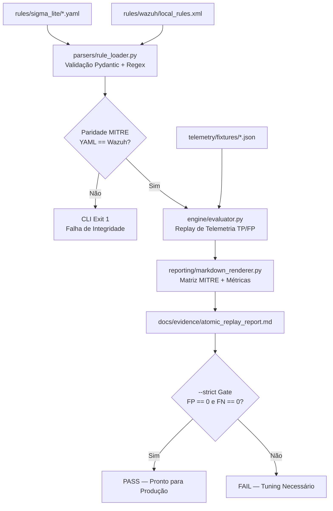

# Arquitetura e Decisões Técnicas (ADRs) — vtx-detection-lab

## 1. Visão Geral do Fluxo Detection-as-Code

O `vtx-detection-lab` aplica práticas de engenharia de software ao ciclo de vida de detecção (Blue Team / Detection Engineering): regras versionadas em Git, validação sintática automatizada, paridade com **Wazuh XML**, *replay* determinístico de telemetria simulada (estilo **Atomic Red Team**) e emissão de relatórios auditáveis com métricas de **Precision** e **Recall**.

## 2. Responsabilidade dos Módulos

| Módulo | Responsabilidade | Contrato / Regra Principal |
| :--- | :--- | :--- |
| `models.py` | Contratos tipados (Pydantic v2) | Normaliza e valida IDs MITRE ATT&CK (`^T\d{4}(\.\d{3})?$`), fontes de log (`sysmon`, `linux_auth`, `auditd`, `wazuh`) e severidades. |
| `parsers/rule_loader.py` | Ingestão e integridade de regras | Carrega YAMLs, impede `rule_id` duplicado, pré-compila regexes e valida a estrutura XML das regras do Wazuh. |
| `engine/evaluator.py` | Motor de avaliação e *replay* | Cruza eventos `.json`/`.jsonl` respeitando `log_source`, calcula `TP`, `TN`, `FP`, `FN`, `Precision` e `Recall`. |
| `reporting/markdown_renderer.py` | Relatório executivo e técnico | Gera boletim Markdown com Quality Gate, matriz MITRE ATT&CK vinculada ao Wazuh SID, alertas disparados e desvios. |
| `main.py` | CLI (Typer + Rich) | Expõe subcomandos `validate` e `replay` com flag `--strict` para integração direta em pipelines CI/CD. |
| `playbooks/` | Resposta a Incidentes (IR) | Procedimentos operacionais de triagem, contenção, erradicação e evidência vinculados a cada `rule_id`. |

## 3. Decisões Arquiteturais (ADRs)

### ADR-01: Formato Duplo Detection-as-Code (YAML Portátil + Wazuh XML)
- **Decisão:** Manter a lógica legível e testável em YAML (`rules/sigma_lite/`) em paralelo às regras nativas do SIEM (`rules/wazuh/local_rules.xml`), exigindo paridade de técnicas **MITRE ATT&CK** via `validate` e `pytest`.
- **Justificativa:** Permite evoluir e testar regras em Python sem depender de uma instância Wazuh em execução durante o desenvolvimento local ou no CI, mantendo artefatos prontos para *deploy* no SIEM.

### ADR-02: Validação Offline com Telemetria Rotulada e Quality Gate (`--strict`)
- **Decisão:** Toda regra deve ser acompanhada por eventos de ataque simulado (`expected_rule_id` preenchido) e controles benignos (`expected_rule_id: null`) em `telemetry/fixtures/`, validados com `--strict`.
- **Justificativa:** Previne regressões silenciosas e reduz fadiga de alertas no SOC ao garantir que alterações de regex ou condições não introduzam falsos positivos nem quebrem detecções existentes.

### ADR-03: Separação entre Detecção e Active Response (Human-in-the-Loop)
- **Decisão:** O laboratório implementa detecção automatizada e playbooks estruturados, mas restringe ações destrutivas ou bloqueios automáticos irrestritos em ativos críticos (`CDE`).
- **Justificativa:** Em ambientes **FinTech / PCI-DSS**, bloqueios automáticos mal calibrados podem causar indisponibilidade operacional (auto-DoS). Contenção ativa exige *allowlist* explícita e validação humana documentada.
